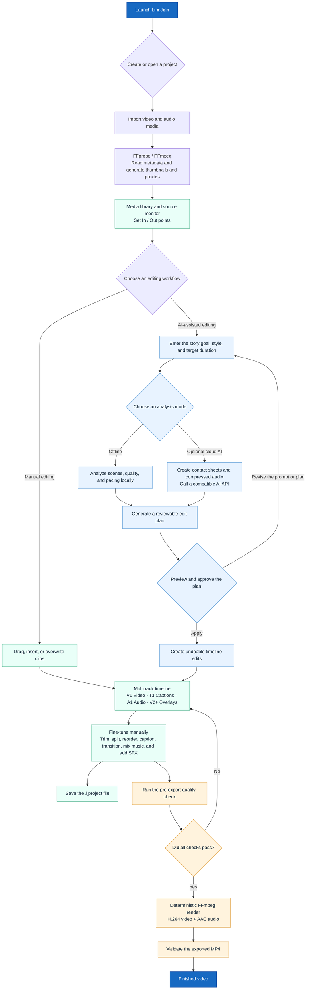
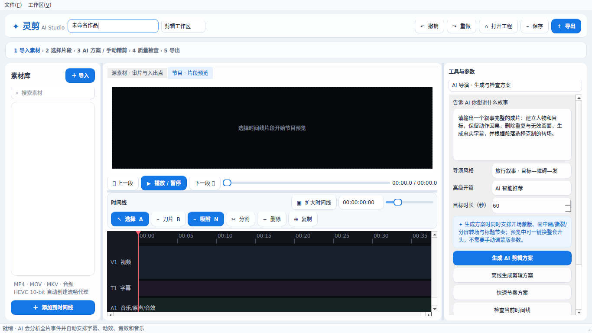

# LingJian AI Video Editor

LingJian is a Windows desktop nonlinear video editor that combines a traditional, editable timeline with optional AI-assisted footage analysis and narrative planning. Local media processing stays on the user's machine; cloud AI is only called after the user provides an API key and starts an analysis.

## Highlights

- Multitrack video, subtitle, original-audio, music, and overlay timeline
- Source/program monitors, in/out points, insert/overwrite editing, trim, split, ripple delete, and undo/redo
- Local scene and quality analysis with proxy generation for difficult media
- Optional multimodal AI analysis through OpenAI-compatible Responses and transcription APIs
- Versioned, reviewable edit plans instead of direct model control over the timeline
- Chronology, clip-boundary, subtitle-readability, transition, and export quality checks
- Deterministic FFmpeg rendering for portrait, landscape, and square H.264/AAC output
- Optional local U²-Net person segmentation and temporally smoothed background effects
- API keys encrypted for the current Windows user with DPAPI

## Editing workflow



The AI path never edits the timeline directly: it produces a validated plan for review, and the user can revise, apply, fine-tune, or undo the result. Imported media and offline analysis remain local; cloud analysis is optional.

## Project layout

```text
.
|-- DOWNLOAD.md             # Windows installer download and checksum
|-- app.py                  # Desktop application and workflow orchestration
|-- core.py                 # Project model, media analysis, and FFmpeg rendering
|-- ai_api.py               # Optional cloud analysis and narrative planning
|-- edit_protocol.py        # Validated, auditable edit-plan layer
|-- timeline_widget.py      # Interactive multitrack timeline
|-- creative_director.py    # Whole-video creative treatment
|-- editing_profile.py      # Locally learned editing preferences
|-- person_ai.py            # Optional local person segmentation
|-- music_library.py        # Bundled generated music metadata
|-- sfx_library.py          # Bundled generated sound-effect metadata
|-- assets/                 # Fonts, music, and sound effects
|-- docs/                   # API setup, current release notes, and design notes
|-- licenses/               # Third-party license texts
`-- tests/                  # Current regression tests
```

## Requirements

- Windows 10 or 11
- Python 3.11+
- FFmpeg and FFprobe available on `PATH`, or `ffmpeg.exe` beside `app.py`

## Run from source

```powershell
git clone https://github.com/MikeKang202210061/lingjian-ai-video-editor.git
cd lingjian-ai-video-editor
python -m venv .venv
.\.venv\Scripts\Activate.ps1
pip install -r requirements.txt
python app.py
```


## Desktop workspace improvements



The desktop editor now offers a compact, tabbed monitor workspace and an optional
dual-monitor review mode. The tool selector exposes every inspector page by name;
parameter panels scroll on small screens, and editing shortcuts respect text-input
focus. The File menu includes Import (`Ctrl+I`), Open (`Ctrl+O`), and Save As
(`Ctrl+Shift+S`). Project writes use a temporary file and replacement so a failed
save does not truncate the previous project. Layout/styles and file persistence
live in separate modules, reusing the existing editing and preview controllers.

See [the research and iteration record](docs/IMPROVEMENT_REVIEW.md) for design
sources, feature tradeoffs, verification, and the next priorities.

With PySide6 installed, run the desktop interaction checks:

```powershell
python -m unittest tests.test_desktop_workspace -v
```

The tests select Qt's offscreen platform by default. Linux shell users can also
set `QT_QPA_PLATFORM=offscreen` explicitly. They do not replace Windows manual QA.

## Scene-aware cloud analysis

The desktop AI Director now scans a small 64×36 proxy locally at four samples per
second. It combines full-video coverage with scene-change and accumulated-motion
samples, keeping at most **24 frames**, grouped into at most **three contact sheets**
of eight frames each. The overview sheets are sent together in one visual request.
Each tile is labelled with its actual decoded presentation time relative to the
source; a cached `manifest.json` records the same mapping. Replacing a source file
invalidates its derived-media cache. If the change scan is unavailable, analysis
falls back to evenly distributed timeline coverage and emits a warning.

In **AI 接口**, optionally enable **候选二次精看**. It is off by default. When enabled,
one additional visual request examines at most eight frames around the two
highest-scoring candidates. A boundary can move by at most one second, must remain
inside the source and the supplied window, and must retain at least half a second.
If refinement fails, the initial plan remains available and the AI status reports
the fallback. The plan still requires review before it reaches the timeline.

These are request-count limits, not a fixed price: image resolution, model pricing,
transcription, generated text, and the separate whole-project planning request all
affect cost. Grouped sheets can cost more than the former single 6×6 overview.
Four-fps scanning and sparse visual review can still miss very short actions;
timestamps identify sampled frames, not guaranteed frame-exact action boundaries.
The unaligned audio transcript provides context, not proof of a particular clip's
dialogue. No new dependencies are required beyond the existing Pillow dependency.

Run the real-media sampling checks with FFmpeg installed:

```powershell
python -m unittest tests.test_visual_sampling_ffmpeg -v
```

## Optional person-segmentation model

Download `u2net_human_seg.onnx`, verify its SHA-256 value against `MODEL_SHA256` in `person_ai.py`, and place it at:

```text
models/u2net_human_seg.onnx
```

The model is intentionally excluded from Git because of its size and separate distribution terms. All non-segmentation editing features remain available without it.

## Tests

```powershell
python tests/run_tests.py
```

Additional generated-media tests in `tests/` require FFmpeg. The portable runner covers edit-plan validation, continuity, long-form ordering, personalization, capture order, and the mocked AI workflow.

## Privacy and AI behavior

- Imported media, proxies, project state, and offline analysis remain local.
- API keys are stored with Windows DPAPI and are not written into project files.
- Cloud analysis sends only the derived contact sheets and compressed audio needed for the requested operation.
- AI output is converted into a validated edit plan that the user reviews before applying.

## Documentation

- [API configuration](docs/API_SETUP.md)
- [Current release notes](docs/RELEASE_NOTES.md)
- [Creative-direction design](docs/CREATIVE_DIRECTION.md)
- [Third-party notices](THIRD_PARTY_NOTICES.md)

## Scope

LingJian focuses on editable AI-assisted assembly, short/long-form narrative planning, subtitles, transitions, multitrack composition, and dependable local export. It is not intended to replace the advanced color, compositing, audio, collaboration, or multicamera systems in a full professional post-production suite.

