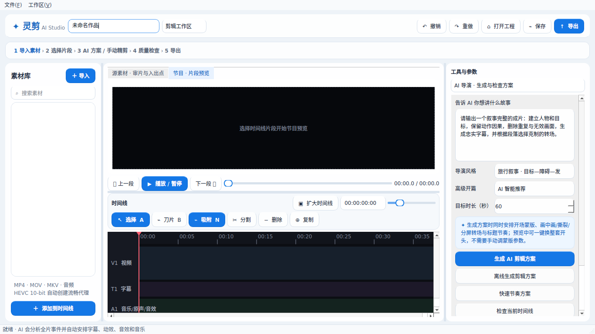

# 灵剪桌面版：研究与迭代记录

范围：`MikeKang202210061/lingjian-ai-video-editor`，Windows 桌面版。
工作分支：`codex/scene-aware-video-analysis`；草稿 PR #1。
用户目标：电脑使用、手机接收；2026-11-04 上午 9:00（America/Los_Angeles）前上传改进。
每轮读取最新远端状态，增量提交；不合并主分支、不调用真实付费模型。

## 第一轮：从导入、编辑到保存的基础体验

### 研究来源与设计依据

| 一手来源 | 观察 | 对灵剪的取舍 |
| --- | --- | --- |
| [Kdenlive 工作区](https://docs.kdenlive.org/en/user_interface/workspace_layouts.html) | 审片、编辑、音频、效果阶段使用不同布局 | 默认剪辑以节目监视器为主，保留可切换双监视器审片；复用现有播放器 |
| [Qt 可访问性](https://doc.qt.io/qt-6/accessible.html) | 界面应适配不同大小；常用操作应支持键盘；颜色不应成为唯一信息来源 | 降低窗口最小尺寸、增加完整工具选择器、改善焦点和文字说明 |
| [Qt QScrollArea](https://doc.qt.io/qtforpython-6/PySide6/QtWidgets/QScrollArea.html) | 参数内容可独立滚动，控件和布局须正确归属 | 包装现有检查器页面，保持原有页序及回调，避免小屏裁掉按钮 |
| [Qt QKeyEvent](https://doc.qt.io/qt-6/qkeyevent.html) | `ShortcutOverride` 需显式接受来阻止全局快捷键抢占 | 编辑文本时保留文字输入、删除和本地编辑键；时间线获得焦点后仍可使用刀片快捷键 |
| [Python os.replace](https://docs.python.org/3/library/os.html#os.replace) | 同一文件系统上的替换操作提供发布完整文件的基础 | 在工程目标目录写临时文件，flush/fsync 后替换，失败保留旧工程并清理临时文件 |

以上是设计依据，不是用户研究统计。没有收集真实使用率，也不据此断言某个效果功能无人使用。

### 用户视角：发现与实施

| 发现 | 已实施 | 验证 |
| --- | --- | --- |
| 原窗口最小高度 800，768 高度笔记本显示受限 | 最小尺寸 1120×680；时间线工具栏分两行；参数页面可滚动 | 离屏检查 1366×768、1120×680，各工具页面可达且不依赖被隐藏的横向滚动 |
| 八个检查器标签挤在一行，完整名称难以发现 | 使用带完整用途的工具选择器，保留底层页序 | 八页切换及可见性检查 |
| 默认双监视器占用大量横向空间 | 单监视器标签式剪辑/双屏审片可切换，记住用户选择 | 多次切换后播放器容器仍有效 |
| 文本编辑与剪辑键需要明确的焦点边界 | 增加输入焦点保护；时间线可键盘聚焦 | 字幕、AI 提示词输入不触发剪辑；时间线 B 键仍切刀片 |
| 保存没有单独“另存为”入口 | 文件菜单新增另存为（Ctrl+Shift+S）、导入（Ctrl+I）、打开（Ctrl+O） | 保存失败不改变当前工程路径 |
| 直接覆盖 JSON，写入中断可能损坏工程 | 手动保存与现有自动保存都经原子写入模块 | Unicode 工程回读、替换失败、序列化失败测试 |
| “时间线输出”容易被理解为已显示全部效果 | 单监视器标签说明为片段预览，提示完整效果需要渲染 | 人工检查文字与实际预览流程一致 |

### 开发者视角：冗余与保留

- 源监视器和节目监视器承担不同职责，不删除；优化默认布局与切换方式。
- 云端、离线、快速节奏三条路径提供不同的语义能力和成本，不能直接删成一条。第一轮缩短常用入口文字，后续可在同一个任务入口中选择模式。
- 多个页面里的“应用”和“效果预览”有上下文用途，不能只按重复文案判定冗余。优先共享动作注册与状态管理，避免复制业务逻辑。
- 蒙版、个性标题和多轨合成属于高级能力。现阶段收拢入口、按需展示，不在缺少使用数据时删除功能或工程字段。
- 外观样式不应和媒体任务、时间线修改混写。提取 `desktop_theme.py`；布局、键盘焦点提取到 `desktop_workspace.py`；文件写入提取到无 Qt 依赖的 `project_files.py`。
- 保留 `Project.save()` 的调用接口，使已有自动保存、测试和工程序列化继续复用同一实现。

### 第一轮结束时的后续候选（最新状态见后续轮次记录）

| 优先级 | 功能/结构 | 用户价值与边界 |
| --- | --- | --- |
| P0 | 自动保存恢复入口、未保存工程提示 | 当前自动保存文件缺乏清晰恢复入口；打开其他工程或退出前需要保护未保存修改 |
| P0 | 统一后台任务生命周期 | 检查重复导出、重复导入、关闭窗口时工作线程仍运行的问题；提供忙碌/失败/完成状态，必要时可取消 |
| P1 | 素材缺失后的重新定位 | 当前打开工程遇到移动素材直接报错；应允许替换路径并校验，不要求重剪 |
| P1 | 从系统拖入文件、素材筛选与计数 | 目前素材库支持向时间线拖动，不等同支持系统文件拖入；需要真实文件拖放测试 |
| P1 | 最近工程、导出后打开目录 | 缩短高频操作；仅保存路径，不保存密钥或上传素材 |
| P1 | 选择状态/空状态反馈 | 未选片段时应明确提示下一步，不让无效动作产生难理解的错误 |
| P2 | 媒体分析、渲染、工程模型继续拆分 | `core.py` 职责较多；逐模块迁移，保持导入兼容和渲染回归，不一次性重写 |
| P2 | AI 接口、密钥存储、叙事策略分离 | `ai_api.py` 同时负责网络、凭据和排序；先固定契约测试再逐步拆分 |

### 第一轮验证结果

- `python tests/run_tests.py`：通过，含原有回归、7 项视觉筛帧测试、新增 3 项工程文件测试。
- `QT_QPA_PLATFORM=offscreen python -m unittest tests.test_desktop_workspace -v`：6 项通过。
- 修改模块通过 `py_compile`。
- Qt 离屏截图人工检查：1366×768 和 1120×680；小屏 AI 页面发现横向截断后，已调整控件尺寸策略和表单换行，并加入回归检查。
- 上一轮 4 项真实 FFmpeg 素材分析检查已通过；本轮没有改动视觉采样算法。
- 环境：Linux 离屏 Qt；没有验证 Windows 窗口管理、真实显示缩放、中文输入法、音频设备、完整效果播放或安装包。
- 没有执行真实付费模型调用，不宣称剪辑质量或费用已在真实用户素材上得到验证。

## 第二轮：未保存保护与恢复副本

### 新研究与取舍

- [Qt for Python Application Example](https://doc.qt.io/qtforpython-6/examples/example_widgets_mainwindows_application.html) 用 `maybe_save()` 统一打开、关闭前的保存判断，并在取消或保存失败时保留当前窗口。灵剪采用同样的交互原则，将判断集中到独立控制器。
- [Kdenlive Auto Save](https://docs.kdenlive.org/en/project_and_asset_management/file_management/auto_save.html) 将自动保存定位为可恢复副本。灵剪明确区分“恢复副本已更新”和“原工程已保存”，不让自动保存清除修改状态。
- 没有另加一个独立“备份管理器”与原保存流程并行维护；文件菜单、启动提示、手动保存和定时保存共享一个 `EditorSession`，纯数据规则独立放在 `project_session.py`。

### 已实施

| 用户问题 | 实际行为 |
| --- | --- |
| 退出或换工程时可能丢失修改 | 提供保存/放弃/取消；取消另存为、保存失败都会取消退出或换工程 |
| 自动保存存在但找不到入口 | 启动时发现副本就显示非模态提示；文件菜单提供“恢复自动保存…”与候选列表 |
| 恢复内容可能直接覆盖原工程 | 恢复为未保存工程，要求另存为；原工程路径和文件不会自动覆盖 |
| 自动保存容易与正式保存混淆 | 标题修改标记和状态栏“未保存修改/已保存/新工程”；恢复副本更新后仍保持未保存状态 |
| 先前窗口的副本可能被新启动覆盖 | 每个窗口使用独立恢复文件；空闲新窗口不覆盖旧副本，也兼容旧版 `autosave.ljproject` |
| 反复自动保存相同内容 | 内容指纹未变化时跳过写入；只有手动保存成功才清理对应副本 |
| 打开失败可能丢掉当前编辑 | 先读取并检查候选工程，再确认是否离开当前工程；损坏文件不改变当前状态 |
| 换工程后仍残留上一工程的画面和素材 | 切换成功后清空旧素材列表、监视器与播放头状态，再导入新工程引用的素材 |
| 打开同一工程并先保存可能读回旧内容 | 保存后重新读取刚保存的版本，避免使用弹窗前读取的旧副本 |
| 工作线程运行时关闭或换工程不安全 | 运行中的导入、代理、分析、渲染或效果任务会阻止关闭/换工程；完整取消和任务管理仍待后续 |

### 结构与边界

- `project_session.py`：无 Qt 依赖的修改指纹、恢复文件身份、枚举与清理规则。
- `desktop_session.py`：保存/打开/恢复/关闭流程和可见反馈；`Main` 原方法保留入口，委托给同一控制器。
- 修改检测比较序列化内容，不依赖撤销栈是否为空；撤销到已保存内容后可恢复干净状态。
- 本轮保护工程格式已保存的内容及工程名、配乐音量。不自动应用尚未点击“应用”的检查器参数，也不恢复未加入工程的素材库、播放器位置或正在运行的任务。
- 恢复副本生成过程不读取 AI 接口配置；继续采用原工程格式与原子写入，不新增网络上传。
- 在后台任务运行期间暂时等待完成再关闭/切换；尚未实现通用任务取消、导出并发限制或完整线程生命周期管理，不能视为这些问题均已解决。

### 第二轮验证

- `python tests/run_tests.py`：通过；新增 6 项纯数据恢复/修改状态测试，保留原有全部便携回归。
- `QT_QPA_PLATFORM=offscreen python -m unittest tests.test_desktop_session tests.test_desktop_workspace -v`：20 项通过，其中 14 项为本轮新增交互测试，6 项为原工作区回归。
- 测试覆盖保存/放弃/取消、保存失败、同文件重新打开、恢复后另存为、原工程不覆盖、跨窗口副本保留、空闲启动、撤销/重做状态和后台任务阻止关闭/换工程。
- 修改模块通过 `py_compile`；恢复提示在 1366×768 离屏窗口中可见。
- 限制仍为 Linux 离屏 Qt，未执行 Windows 实机、真实输入法、媒体设备或付费模型验收。

### 第二轮结束时的后续优先级

继续优先处理后台任务并发、完成/失败状态与安全退出；其次为素材重新定位、系统文件拖入和未选片段的可见反馈。新增恢复功能后，不再重复建立另一套保存或恢复入口。

## 第三轮：可取消导出与输出保护

本轮从分支 `05e60e5bc3a8ee2508110d6c75d9e1a9e48d9a3a` 和最新草稿 PR #1
开始，先核对前两轮记录与当前实现，仅处理导出事务及共用渲染进程。

### 一手研究与功能取舍

| 来源 | 发现与本轮取舍 |
| --- | --- |
| [Qt QThread](https://doc.qt.io/qt-6/qthread.html) | 线程对象和执行线程具有不同归属，完成信号与清理应明确；请求中断不会自动停止任务。保留工作线程到 `finished`，用事件通知工作逻辑取消，不调用 `QThread.terminate()` |
| [Python subprocess](https://docs.python.org/3/library/subprocess.html) | 管道需持续读取；终止子进程后仍须等待退出。将日志读取与取消轮询分开，编码无日志时也能取消；终止超时再 kill，并回收子进程 |
| [Python os.replace](https://docs.python.org/3/library/os.html#os.replace) | 先在目标同目录编码和校验，再替换目标文件；保留旧成片直到新成片准备好。它不等同断电后的持久性保证 |

这轮沿用现有顶部导出按钮、导出检查器和效果预览入口，不新增并行的“导出管理器”
页面，不删除高级效果。两个导出入口复用一个控制器，保留原质量门禁与提醒。

### 已实施与结构

| 原风险或用户流程 | 实际变化 |
| --- | --- |
| 重复触发导出会替换仍在运行的线程引用 | 每个窗口只允许一个最终导出事务；两个按钮同步禁用，程序再次调用也受同一忙碌检查保护 |
| 看不出导出在哪、无法停止长任务 | 启动后定位导出检查器，显示进度和“取消导出”；原导出按钮灰显并改为“导出中…”，避免仅用颜色表示状态；取消后等待清理，完成后恢复操作，可重试 |
| FFmpeg 直接覆盖最终路径，失败会破坏旧成片 | 写入同目录唯一 `.part.mp4`；编码和现有兼容性校验都成功才替换，失败/取消保留旧输出 |
| 改用临时文件后可能绕过 FFmpeg 的同文件保护 | 启动前和进程层都校验输出与 `-i` 输入，包含路径解析、硬链接及符号链接，禁止覆盖素材 |
| 编码异常可能没有结果反馈 | 创建进程、编码失败、校验失败、发布失败和意外线程异常都进入结果状态；失败可重试 |
| 渲染期间继续编辑，输出范围容易混淆 | 明确提示导出使用启动时的时间线快照；保留原时间线静音处理，后续修改不改变该次任务 |
| 直接共用成片校验会误拒绝很短的预览 | 共用进程处理；成片沿用原 H.264/尾部校验，预览使用媒体可读性检查，允许小于 4096 字节的合法预览 |

- `render_jobs.py`：无 Qt 依赖的进程生命周期、取消事件、有限日志尾部、输入保护和输出发布。
- `desktop_render.py`：导出/效果预览共用的 Qt 桥接，向原预览接口继续发出 `done`；不可预期异常也返回失败。
- `desktop_export.py`：单个窗口的导出状态、按钮、完成/取消/错误反馈；`Main.export()` 只委托，不再在 GUI 线程重复校验。
- 进度在编码期间最多 99%，发布完成才到 100%。日志持续排空，显示回调异常不阻断排空。
- 正常完成、失败和取消会回收子进程并移除临时文件；系统拒绝清理时，结果消息保留具体清理错误及临时路径。

### 第三轮验证

- `python tests/run_tests.py`：通过；新增 10 项进程测试，保留原有工程、保存/恢复、视觉采样和编辑计划等全部便携回归。AI 测试仅使用本地模拟。
- `python -m unittest tests.test_render_jobs_ffmpeg -v`：4 项通过。真实编辑命令生成并验证 H.264/AAC 成片；无效输入保持旧文件；运行中取消 FFmpeg；短预览合法且小于最终导出大小门槛。
- `QT_QPA_PLATFORM=offscreen python -m unittest tests.test_desktop_export tests.test_desktop_session tests.test_desktop_workspace -v`：31 项通过，其中新增 11 项导出检查，另有原 14 项会话和 6 项工作区回归。
- 新测试覆盖：重复启动/引用保持、取消到完成期间保持忙碌、取消后重试、成功/失败/启动异常、时间线快照/静音、输入覆盖、窗口关闭保护、真实 QThread 异常信号和小窗口取消控件可达性。
- 纯进程检查还覆盖：无输出的子进程取消、校验中取消、缺少 FFmpeg、发布失败、硬/软链接输入保护、大量 stderr 与显示回调抛错。先前输出在失败路径保持逐字节一致。
- 修改的程序和测试模块通过 `py_compile`。离屏窗口在 1366×768 和 1120×680 人工检查导出运行状态；截图使用可控测试工作线程，真实媒体行为由上述 FFmpeg 测试独立验证。

### 限制与后续

- 环境为 Linux 离屏 Qt，尚未完成 Windows 实机、显示缩放、中文输入法、设备和安装包验收；没有调用真实付费模型。
- 本轮仅限制同一窗口的最终导出，效果预览仍是独立任务；未提供跨窗口/跨进程同路径导出的仲裁。
- 取消发生在校验阶段时，等待现有同步校验返回再丢弃临时文件；没有给所有媒体探测和校验增加通用超时。
- 输入路径校验基于启动时文件状态，不承诺抵御其他程序同时替换路径；系统拒绝停止或删除时会报告错误。
- 仍需处理重复导入/其他后台任务生命周期与通用取消。素材重新定位、系统拖入、未选中状态反馈继续保留为后续候选，本轮不扩展功能。

## 后续记录规则

每轮追加研究来源、取舍、实际修改、运行过的验证及限制。每轮先推送通过检查的增量，
8:30 之后只做验收、阻塞问题修复与交付汇总，避免最后才推送大批未验证修改。
